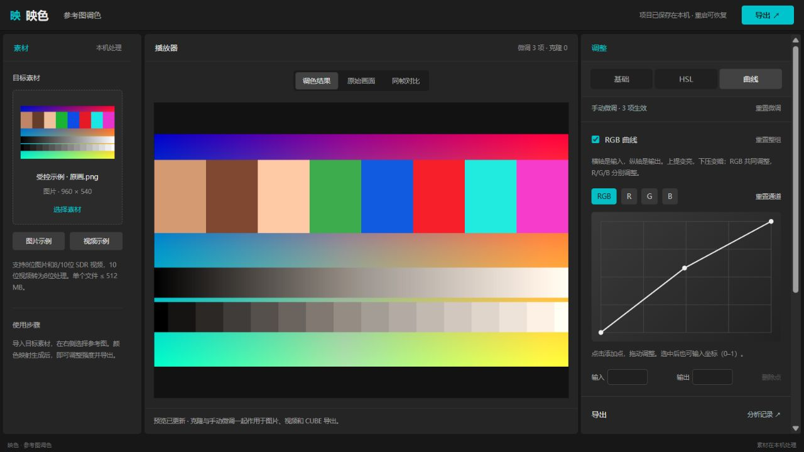

# 手动调色：从哪里开始

版本：1.1 手动调色版，源码里程碑 `feature/manual-controls-20261106`。仅主开发版新增；肤色保护实验副本保持原版。

## 建议操作顺序

1. 导入目标图片或视频，再选参考图，先用色彩克隆得到整体风格。
2. 在“基础”调整冷暖、饱和度和明暗。不要一开始把所有滑块都拉动。
3. 某种颜色单独不合适，再到 HSL 选对应色圈；它按颜色范围作用，不识别物体或人物。
4. 需要精细明暗或通道控制时，再使用曲线。横轴是输入，纵轴是输出，上提变亮、下压变暗。
5. 查看“原始画面”或“同帧对比”，满意后导出。视频预览仍为选定分析帧，整片视频在导出时处理。



桌面端预览保持可见，右侧面板独立滚动。顶部“导出”会定位导出区；切换调色页签会回到面板顶部，不把新工具藏在上一次的滚动位置。

## 控件有什么用

| 分组 | 使用场景 |
| --- | --- |
| 色温／色调 | 修正偏冷偏暖、偏绿偏洋红 |
| 饱和度／自然饱和度 | 整体颜色浓淡；自然饱和度对已有高饱和颜色影响较小，不是肤色保护 |
| 亮度／对比度 | 调整总体明暗和明暗差距 |
| 高光／阴影 | 较多影响亮部或暗部，权重平滑，不是按物体分区 |
| 白色／黑色 | 更集中控制亮端、暗端；极端值可能剪切细节 |
| 光感 | 温和改变中间调，不等于识别或重建光源 |
| HSL 八色 | 分别改变某类颜色的色相、饱和度、亮度；相邻色段平滑重叠 |
| RGB／R／G／B 曲线 | 总体或单通道映射，适合手动做明暗曲线与偏色修正 |

曲线点击添加点，拖动调整，或选点后输入 0–1 坐标。内部控制点可删除，端点不能删除；“重置通道”只重置当前通道。第一版采用分段直线，最多 16 点；极陡曲线在 64³ LUT 中可能出现近似误差或断层。

## 开关与重置

- 关闭“色彩克隆”只停用参考图匹配，保留其强度；手动微调仍生效。
- 关闭基础、HSL 或曲线分组，暂时停用该组，不删除数值。
- 单项重置恢复 0；整组重置恢复默认并启用该组。
- “重置微调”恢复全部手动设置，不改参考图、目标素材或克隆强度。
- “原始画面”始终是不含克隆和手动调整的素材，用于比较。

设置随项目自动保存；重启后恢复。导出开始时冻结当前设置，导出期间再改参数不会改变已开始的任务；旧结果会提示按新设置重新导出。

## 图片、视频与 CUBE

固定顺序为：参考图克隆 → 基础 → HSL → 总 RGB 曲线 → R/G/B 曲线。非中性设置组合成同一张 64³ LUT，PNG、视频和 CUBE 使用同表采样。全部默认值走旧路径，避免改变已有结果。

PNG 与 CUBE 对照在受控测试中一致；视频会额外产生 H.264 与色度采样误差。现有视频音轨、时间戳策略保留；10 位 SDR 仍转 8 位处理，不新增 HDR／Log 支持。滑块量程是映色自己的定义，不代表剪映同名数值或内部算法。

色轮、空间锐化、颗粒、暗角、蒙版和关键帧尚未实现，因此不显示空控件。所有微调都由用户决定，不承诺任意调整自动提高画质。

## 开发与验证

算法在 `reference_color_app/adjustments.py`，控件在 `reference_color_app/web/adjustments.js`；克隆分析公式不变。参数规范化、组合映射、输出快照和旧请求兼容均有检查。

```powershell
.\.venv\Scripts\python.exe scripts\run_portable_tests.py
node --test tests\reference_color\web_restore.test.cjs
.\.venv\Scripts\python.exe scripts\verify_manual_controls.py .\dev-data\manual-check
```

Node 仅用于前端回归测试，运行软件不需要安装 Node。最后一条命令生成合成测试素材、PNG／CUBE／短视频和核验记录，不依赖私人媒体。[本批验证记录](research/2026-11-06-manual-controls/README.md)
