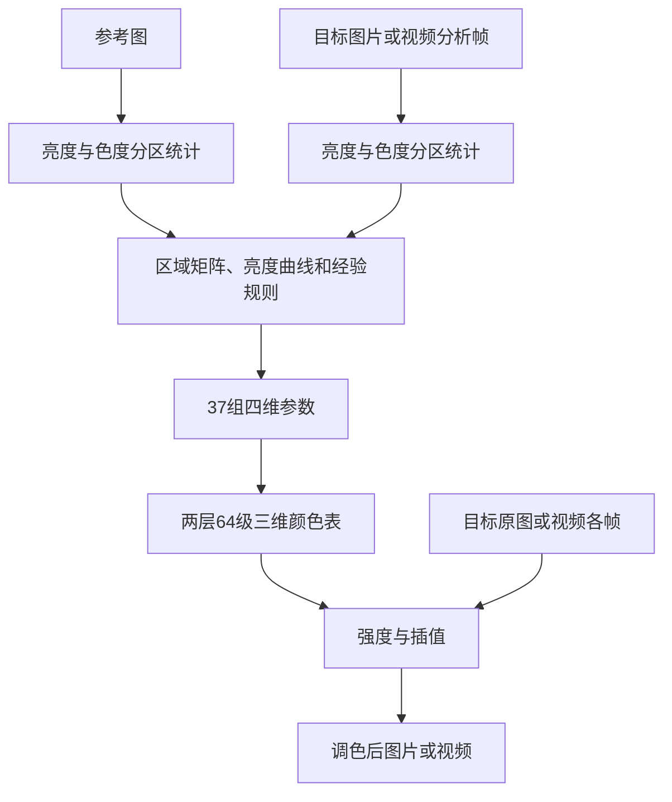

# 参考图调色内核：当前恢复到哪里

2026-10-16当前输入策略更新：用户已明确批准10位SDR兼容导入。10位视频在进入既有8位特征/着色流程前转换到RGB8，导出为8位；HDR/BT.2020、未知和其他高位深继续拒绝，图片仍限8位。此为兼容支持，不是剪映原生10位处理链的恢复。算法摘要因media.py变化更新为 `0024ea158e5b3d7dca14195c806b80beb9236be13b534470f2d04f5e14364514`，颜色统计、矩阵、参数、曲线和LUT数学文件未改。旧摘要及8位限定的记录保留为历史；详见[修复记录](../outputs/video10-validation/修复记录.md)。

当前独立内核能够读取参考图和目标图像，计算颜色映射，再应用到图片或视频帧。恢复依据来自本机剪映11.6.0.14552的资源、反编译函数、真实特征缓存和人工导出。独立App已有本地界面和Windows便携包，Tasks 1–8 通过独立审阅；Task9文档提交最终广泛审阅。入口见[使用说明](reference-color-usage.md)、[交付和逐项证据索引](reference-color-acceptance.md)、[实际验证报告](../outputs/reference-color-validation/验证报告.md)。

## 它具体在做什么

颜色空间可以理解为描述颜色的一套坐标。这里先把RGB转换成亮度Y和两项色度U/V，便于分别处理明暗与偏色。目标视频会先选择一个分析画面；本软件明确用这帧计算的映射处理整段导出。

内核统计两张图在暗部、中间调、高光区域的亮度、饱和度、色度均值和协方差。均值反映一组颜色偏向哪里，协方差描述颜色分布向哪些方向展开；根据两组统计求出各区域的色度变换，再经过原生恢复出的限幅、肤色附近保护、亮度曲线和混合规则。

这些结果被打包成37组四维参数，生成两层64×64×64颜色表。表中的每个位置存储某种输入RGB应变成什么RGB。实际处理图片时查表并插值；视频逐帧使用同一映射。强度还涉及原图与两层颜色表的分段混合，不能只看作与最大效果取一个固定比例。

## 现在的证据

- 特征提取、矩阵与参数、双层颜色表、图片应用和组合.cube都已成为独立Python模块；运行不读取剪映DLL、模型或其缓存。
- 用户提供的测试视频在1秒取帧、配暖色参考图，独立完整管线对50/100强度剪映导出的RGB平均绝对差约1.73/1.85（0—255尺度）；局部最大差64，不能由平均值掩盖。
- 将提取的着色器适配后在系统NVIDIA OpenGL执行，与CPU实现的颜色表比较，已测试的有色/灰色分支最大差均为1色阶。系统GL环境与剪映实际运行环境仍有区别。
- 新增静态审计修正了退化矩阵初值和非单调区域阈值的分支顺序；没有用自选回退替代原生逻辑。

## 精度与保存边界

原生输入纹理的解码、宿主预处理、部分GPU舍入、UI完整强度刻度和对象复用状态仍未全部取得运行中间量。当前实现采用有证据支持的新对象计算链；独立软件选择固定分析帧是已批准的产品设计，尚未据此断言剪映始终采用相同的视频更新策略。

63/57项原生特征布局已有真实252/228字节缓存支持；目标纹理像素与缓存字节全量相同尚未证明。独立App自己的媒体、映射缓存和项目记录使用可验证的自有格式，保留输入、分析时间、算法摘要和诊断，不宣称兼容剪映草稿。

精确数据及条件见[首次对照](../outputs/jianying-color/deep/独立映射链首次对照.md)、[GPU对照](../outputs/jianying-color/deep/系统GPU与CPU着色器对照.md)、[区域顺序审计](../outputs/jianying-color/deep/region-order-audit.md)、[原生退化状态](../outputs/jianying-color/deep/degenerate-state-audit.md)。实施进度以[台账](../.superpowers/sdd/2026-10-15-reference-color-app/progress.md)为准。

## 证据分级与当前交付

2026-10-16 晚间续查：界面改为剪映色彩克隆面板风格，算法文件未改，摘要仍为 `3fe2b1eafd3e2498017b0172faf0dfed2ba5ae985b2d88b1689c6c4e7ff03405`。新增[输入预处理证据](../outputs/jianying-color/deep/20261016-preprocess-followup.md)和[渲染/强度证据](../outputs/jianying-color/deep/20261016-render-followup.md)。需要保留“原生LUT复制到新RenderTexture后才供最终采样”这一未闭合环节：生成纹理LINEAR不能单独证明复制后纹理的过滤与色彩解释。界面相似及有限输出误差均不构成算法完全一致证明。

原生资源源码/反编译确定了采样、参数规则、亮度曲线和双表混合的具体链路；反编译伪代码不是原始C++源码。真实缓存、用户剪映50/100导出、系统GPU、独立程序与浏览器运行各有范围，不能互相替代。协方差解释与误差来源假设属于数学推导/推断，固定帧映射及自有JSON/NPZ项目缓存属于独立设计。

真实暖色视频0/1/3/7秒MP4对原生50档MAE1.4501–1.4827、100档1.3519–1.4289；各自最终静止帧PTS不同，误差另为2.1316/2.1748，p95均7。只是一套合成场景，不给全片误差上界。七组受控参考测试、16对纯色退化测试无对应剪映导出；同图100档仍会变化，不能承诺恒等。实际ASCII组合cube由独立FFmpeg reader测试8192随机RGB和1250切片边界，四档非零最大1字节；不是原生一致性证明。精确数据见验证报告及[指标](../outputs/reference-color-validation/metrics.json)。

原生输入/UI绑定依据资源流向、缓存参考身份及实际暖色导出形成当前可用对应：本软件目标→63项mode0，参考→57项mode1。缓存PNG接近暖参考不能单独证明完整宿主UI绑定，原生目标输入像素仍未知。原生三路径持久化、自有缓存键/项目字段、强度及状态生命周期的逐项对应与未知见验收索引，不声称兼容剪映草稿或已恢复对象复用更新。

2026-10-16 最终精度修复：视频在RGB24转换前读取FFmpeg像素格式的各分量位深；超过8位、浮点及无法确认精度的输入明确拒绝。真实10位BT709 SDR上传返回400；真实8位YUV/RGB/灰度控制正常。此为独立App输入策略，不是原生算法恢复结论。修复后Python完整60项通过；受影响受控批次、cube、16对纯色及首尾帧诊断已重做，8位数值结论不变。当前算法摘要 `3fe2b1eafd3e2498017b0172faf0dfed2ba5ae985b2d88b1689c6c4e7ff03405`。
