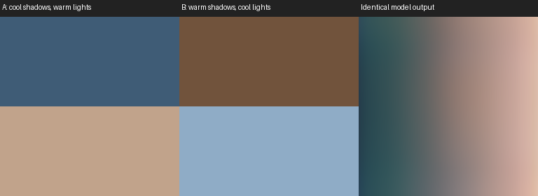

# 参考图关系表示：当前限制与下一步

本轮发现一项与目标直接相关的限制：当前研究模型只接收参考图Y′、Cb、Cr的三条独立直方图。这些特征会丢失亮度与颜色的关联，无法完整表示“暗部是什么颜色、亮部是什么颜色”。目标图仍有低分辨率空间分支，不能因此说整个模型完全没有内容判断或语义先验。

## 已运行的反证

构造两张256×256 RGB8参考图，使用作者原始Y′CbCr转换及128-bin直方图代码核对，三条直方图逐值相同。两图的亮度—色度协方差符号相反，配色关系不同。固定同一灰阶目标图后，冻结第8轮模型生成的空间网格最大差为0，输出不同码值数量为0，输出SHA256也相同。

| 参考 | 暗部RGB | 亮部RGB |
|---|---|---|
| A：暗冷、亮暖 | 63,92,118 | 193,163,139 |
| B：暗暖、亮冷 | 113,83,60 | 143,172,198 |

运行入口：`experimental/adaptive-reference-20261113/check_reference_joint_limit.py`。这是表示能力反例，不是自然图片审美测试，不用它虚构新算法的效果分数。它证明只继续训练相同输入特征，无法区分这个特定反例；不能证明所有实际失败都由此造成。

另将一张真实参考图整幅缩至256后随机打乱像素，保留RGB颜色样本，网格及输出也完全相同。该项证实当前不使用参考图布局；不能直接从中推断目标图分支不具有任何内容先验。

## 原尺寸照片补验

按原开发验证组顺序固定前6张，非按效果选图，原尺寸范围360×540至1024×683。完整读取经哈希核对的ICC准备副本，未训练或改变模型。沿用0.1码值阈值，得到4改善、1相近、1退化；平均RGB MAE为旧版18.080、新版14.125，原图不处理14.948。均值受大改善样例影响，不能据此声称普遍更协调。

查看原尺寸对照发现，新版能减少某些场景把背景固有颜色迁移到整幅图的情况，但花卉等样例仍可能不如旧版。此前保留32组里的强烈青蓝暗部及特殊偏色样例也仍存在迁移不足。照片真值来自预设生成与筛选，像素误差不等于自然度或人工偏好；未补齐原计划的多人匿名主观评价。

## 延长训练没有达到推进门槛

沿用128训练／32开发验证，从第8轮固定权重出发，重新初始化AdamW，以学习率1e-5再训练24轮／768步。训练前冻结`triplet-extension-protocol.md`及脚本、配置、数据哈希；仅在预定12、16、20、24、28、32轮评估，不使用此前保留32组图片或真值选型。

最佳为第16轮：验证均值14.26696→14.11895，改善1.037%；14/32组改善，0严重退化。没有通过预先规定的至少5%均值改善、至少20组改善门槛。训练损失持续下降而验证提升很小，结果不支持继续只增加这一小数据集上的训练轮数。新权重不替换App，也不据此消耗新的独立测试。

## 下一步优先问题

优先研究如何保留参考图的亮度—色彩联合关系，而不是先增加人物分割和复杂控件。可以先在独立候选中加入按亮度条件统计的色度／饱和度特征，对照现有独立直方图，验证上述反例能否被区分，再用同一开发集的监督训练检查自然照片是否受益。

上述假设随后已经完成首轮条件色度特征实验，但没有通过开发推进门槛，不接入App，详见[首轮联合条件特征对照](2026-11-13-joint-feature-pilot.md)。联合统计仍不等于人物与背景对应；人物和背景出现相同颜色、相同亮度时依然可能无法区分。只有通过完整对照与新的独立评估，才考虑接入可操作版本。现有目标保持不变：自适应迁移颜色、明暗、饱和度关系，画面更协调，操作快速简单。

本机证据：`outputs/adaptive-reference-20261113/tst100k/native-photo-v1`、`tst100k/training-v2`及`reference-joint-limit-v1`。不将个人摄影视频、数据集照片、权重或会话令牌提交到Git；研究许可限制不变。
